# Kế Hoạch Triển Khai Backend Elevator Simulation System (Roadmap & Action Items)

- **Mã tài liệu:** `2609292233-backend-implementation-roadmap.md`
- **Ngày tạo:** 2026-09-29 22:33 (GMT+7)
- **Thời hạn hoàn thành:** 2 ngày chuẩn bị bài test

---

## 1. Mục Tiêu (Objectives)

Xây dựng hệ thống Backend hoàn chỉnh cho bài test Elevator Simulation đáp ứng toàn bộ các tiêu chí:
1. Tuân thủ triệt để các nguyên lý **OOP (Encapsulation, Inheritance, Polymorphism)**.
2. Vận hành chính xác hệ thống 3 thang máy chạy song song qua 10 tầng với thuật toán **LOOK / SCAN** và **Nearest Suitable Dispatching Strategy**.
3. Xử lý chuẩn xác vòng đời cửa thang máy (**Dwell Timer, Open/Close buttons**).
4. Cung cấp API REST và WebSocket Gateway theo thời gian thực (Realtime Simulation).
5. Đạt độ phủ kiểm thử (Unit Tests) cao cho các kịch bản edge case.

---

## 2. Kế Hoạch Thực Hiện Theo Từng Giai Đoạn (Execution Roadmap)

```mermaid
gantt
    title Kế Hoạch Triển Khai Backend Elevator
    dateFormat  HH:mm
    axisFormat  %H:%M
    section Phase 1: Setup & Domain
    Khởi tạo NestJS & TypeScript           :p1_1, 00:00, 30m
    Xây dựng Request Hierarchy (OOP)      :p1_2, after p1_1, 45m
    Xây dựng Entity Door & Elevator       :p1_3, after p1_2, 60m
    section Phase 2: Algorithm & Simulation
    Dispatching Strategy Pattern          :p2_1, after p1_3, 45m
    ElevatorSystem & Simulation Engine    :p2_2, after p2_1, 45m
    section Phase 3: Web APIs & Gateway
    REST Controller & DTO Validation      :p3_1, after p2_2, 45m
    WebSocket Gateway & Event Emitter     :p3_2, after p3_1, 45m
    section Phase 4: Testing & Polish
    Unit Tests Suite (Domain & Algorithm) :p4_1, after p3_2, 60m
    Integration & Edge Cases Verification :p4_2, after p4_1, 30m
```

---

## 3. Danh Sách Tác Vụ Chi Tiết (Detailed Action Items)

### Giai Đoạn 1: Thiết lập Dự Án & Lõi Domain (Domain Modeling)
- [ ] **Task 1.1:** Khởi tạo dự án NestJS trong thư mục `elevator-be` với TypeScript, cài đặt các package cần thiết (`@nestjs/websockets`, `@nestjs/platform-socket.io`, `socket.io`, `class-validator`, `class-transformer`).
- [ ] **Task 1.2:** Định nghĩa các Enum và Constant (`Direction`, `ElevatorState`, `DoorState`, `NUM_FLOORS = 10`, `NUM_ELEVATORS = 3`).
- [ ] **Task 1.3:** Xây dựng hệ thống class phân cấp `ElevatorRequest`:
  - `ElevatorRequest` (abstract base).
  - `HallRequest` (abstract với thuộc tính `Direction`).
  - `UpHallRequest` và `DownHallRequest` (override `canBeServedBy`).
  - `DestinationRequest` (override `canBeServedBy`).
- [ ] **Task 1.4:** Xây dựng Entity `Door` (đóng gói logic `dwellTimer`, `open()`, `close()`, `tick()`).
- [ ] **Task 1.5:** Xây dựng Entity `Elevator` (đóng gói State Machine, LOOK algorithm, danh sách request).

### Giai Đoạn 2: Thuật Toán Dispatcher & Simulation Engine
- [ ] **Task 2.1:** Thiết kế Interface `ElevatorSelectionStrategy` và class triển khai `NearestSuitableElevatorStrategy`.
- [ ] **Task 2.2:** Xây dựng class `ElevatorDispatcher` để tính toán score và gán request cho thang máy tối ưu.
- [ ] **Task 2.3:** Xây dựng `ElevatorSystem` làm Aggregate Root kết nối 3 thang máy và Dispatcher.
- [ ] **Task 2.4:** Xây dựng `SimulationEngine` chạy interval loop (1 tick / giây) kích hoạt `ElevatorSystem.tick()` và phát event.

### Giai Đoạn 3: REST API & Realtime WebSocket Gateway
- [ ] **Task 3.1:** Định nghĩa các DTO (`CallElevatorDto`, `SelectDestinationDto`) kèm decorator của `class-validator`.
- [ ] **Task 3.2:** Xây dựng `ElevatorController` cung cấp các endpoint REST:
  - `POST /api/elevators/call`
  - `POST /api/elevators/:id/destination`
  - `POST /api/elevators/:id/door/open`
  - `POST /api/elevators/:id/door/close`
  - `GET /api/elevators`
- [ ] **Task 3.3:** Xây dựng `ElevatorGateway` với Socket.IO để phát sóng broadcast `simulation:tick` và các sự kiện tức thì (`elevator:arrived`, `elevator:door_state_changed`).

### Giai Đoạn 4: Kiểm Thử Tự Động (Unit Testing) & Đánh Giá
- [ ] **Task 4.1:** Viết Unit Test cho `Door` (kiểm tra dwell timer, lệnh open/close).
- [ ] **Task 4.2:** Viết Unit Test cho `Elevator` (kiểm tra di chuyển LOOK, không dừng ngược chiều, an toàn khi mở cửa).
- [ ] **Task 4.3:** Viết Unit Test cho `NearestSuitableElevatorStrategy` (kiểm tra phân bổ khi thang đang IDLE, đang chạy cùng chiều, đang chạy ngược chiều).
- [ ] **Task 4.4:** Viết Test cho các Edge Cases (gọi trùng lặp, gọi ở tầng biên, bấm nhiều tầng đích).

---

## 4. Tiêu Chí Nghiệm Thu (Acceptance Criteria)

1. **Tính Đúng Đắn Về Nghiệp Vụ:**
   - [x] Thang máy đang đi lên chỉ dừng ở tầng có gọi lên hoặc đích đến; bỏ qua yêu cầu gọi xuống (và ngược lại).
   - [x] Nút Open giữ cửa mở; nút Close đóng cửa ngay lập tức.
   - [x] Thang tuyệt đối không di chuyển khi cửa đang mở hoặc đang đóng dở dang.
2. **Tính Chuẩn Mực Về Code & OOP:**
   - [x] Thể hiện rõ ràng `Encapsulation`, `Inheritance`, `Polymorphism` và `Strategy Pattern`.
   - [x] Domain Core hoàn toàn độc lập, không bị lẫn logic của Web Framework.
3. **Hiệu Năng & Ổn Định:**
   - [x] Simulation chạy mượt mà theo từng giây (tick-based).
   - [x] WebSocket client nhận đầy đủ dữ liệu đồng bộ tức thì.
   - [x] Bộ Unit Test chạy pass 100%.

---

## 5. Rủi Ro & Giải Pháp Dự Phòng (Risks & Mitigations)

| Rủi ro tiềm ẩn | Mức độ | Giải pháp phòng ngừa |
| :--- | :---: | :--- |
| **Race condition khi nhiều request gửi tới cùng 1 tick** | Trung bình | Xử lý tuần tự trong Memory queue trước khi thực hiện bước `tick()` tiếp theo. |
| **Thang máy bị kẹt trạng thái (Deadlock / Starvation)** | Thấp | Thuật toán LOOK đảm bảo mọi request trong hàng đợi đều sẽ được duyệt tới khi thang đảo chiều. |
| **Lệch pha nhịp hiển thị giữa FE và BE** | Thấp | FE sẽ đóng vai trò Renderer dựa trên Stream Snapshot từ WebSocket thay vì tự tính toán vị trí. |
