# Kế Hoạch Triển Khai Frontend Elevator Simulation (Roadmap & Action Items)

- **Mã tài liệu:** `2609301649-frontend-implementation-roadmap.md`
- **Ngày tạo:** 2026-09-30 16:49 (GMT+7)
- **Công nghệ cốt lõi:** Node v24.21.0 + React 19 + TypeScript + Vite + Socket.IO Client + Vanilla CSS / Modern UI + Eslint + Cài bằng yarn
- **Mục tiêu:** Xây dựng giao diện mô phỏng 3 thang máy chạy song song qua 10 tầng chuẩn xác theo đề bài và wireframe mẫu, kết nối realtime với Backend.

---

## 1. Mục Tiêu & Yêu Cầu Giao Diện (Objectives & UI Requirements)

1. **Hiển thị Tòa Nhà Trực Quan (Building Visualization):**
   - 10 tầng (Floor 1 đến Floor 10) và 3 trục thang máy (Elevator 1, Elevator 2, Elevator 3) hoạt động song song.
   - Hiển thị chính xác vị trí cabin, hướng di chuyển (`UP`, `DOWN`, `IDLE`), và trạng thái cửa (`OPEN`, `CLOSED`, `OPENING`, `CLOSING`).
2. **Hệ Thống Nút Điều Khiển Đầy Đủ:**
   - **Nút gọi tại sảnh (Hall Call Buttons):** Nút `UP` và `DOWN` tại mỗi tầng (Tầng 1 chỉ có `UP`, Tầng 10 chỉ có `DOWN`). Có hiệu ứng highlight khi request đang active.
   - **Nút điều khiển cửa (Door Controls):** Nút `OPEN` (giữ/reset mở cửa) và `CLOSE` (đóng cửa ngay lập tức) bên cạnh mỗi cabin thang máy theo đúng wireframe.
   - **Bảng chọn tầng đích (Destination Panel):** Bàn phím số 1–10 bên trong cabin, chỉ cho phép bấm chọn khi cửa thang máy đang mở.
3. **Bảng Theo Dõi & Quan Sát (Monitoring & Diagnostics):**
   - **Elevator Status Panel:** Bảng tóm tắt trạng thái 3 thang máy (Tầng hiện tại, Hướng, Trạng thái, Danh sách đích đến).
   - **Event Log:** Lịch sử ghi nhận các sự kiện hệ thống theo thời gian thực (User request, Thang di chuyển, Thang cập tầng, Cửa đóng/mở).
4. **Kiến Trúc Chuẩn Mực (Feature-Based Modular Architecture):**
   - Tuyệt đối không chứa logic/thuật toán điều phối thang máy ở Frontend.
   - Quản lý state bằng `useReducer + Context API`, nhận luồng sự kiện từ WebSocket và phát lệnh qua REST API.

---

## 2. Cấu Trúc Thư Mục Frontend (Directory Structure)

```text
elevator-fe/
├── src/
│   ├── app/
│   │   ├── App.tsx                    # Layout chính của ứng dụng
│   │   ├── AppProvider.tsx            # Bọc Context Providers
│   │   └── config.ts                  # Cấu hình API URL, WebSocket URL, Constants
│   │
│   ├── features/
│   │   └── elevator/
│   │       ├── components/
│   │       │   ├── Building/
│   │       │   │   ├── Building.tsx            # Khung tòa nhà 10 tầng x 3 trục giếng thang
│   │       │   │   ├── FloorRow.tsx            # Hàng của từng tầng
│   │       │   │   ├── FloorNumber.tsx         # Nhãn số tầng
│   │       │   │   └── HallCallButtons.tsx     # Nút UP/DOWN tại sảnh tầng
│   │       │   │
│   │       │   ├── Elevator/
│   │       │   │   ├── ElevatorShaft.tsx       # Trục giếng thang máy
│   │       │   │   ├── ElevatorCabin.tsx       # Cabin thang máy hiển thị tại tầng hiện tại
│   │       │   │   ├── ElevatorDoor.tsx        # Hoạt họa đóng/mở 2 cánh cửa
│   │       │   │   ├── ElevatorControls.tsx    # Nút Open Door / Close Door
│   │       │   │   └── DestinationPanel.tsx    # Bàn phím chọn tầng đích (1-10)
│   │       │   │
│   │       │   ├── StatusPanel/
│   │       │   │   └── ElevatorStatusPanel.tsx # Bảng trạng thái chi tiết 3 thang máy
│   │       │   │
│   │       │   └── EventLog/
│   │       │       └── EventLog.tsx            # Danh sách log sự kiện realtime
│   │       │
│   │       ├── model/
│   │       │   ├── types.ts           # Định nghĩa Entity, State, Event DTOs
│   │       │   ├── state.ts           # Initial State của Elevator Feature
│   │       │   ├── actions.ts         # Union Type các Action của Reducer
│   │       │   ├── reducer.ts         # Xử lý State Transitions từ WebSocket events
│   │       │   └── selectors.ts       # Selectors trích xuất dữ liệu cho UI
│   │       │
│   │       ├── api/
│   │       │   └── elevator.api.ts    # REST Client (Call Elevator, Destination, Open/Close Door)
│   │       │
│   │       ├── websocket/
│   │       │   └── elevator.socket.ts # Socket.IO client, subscribe & unsubscribe events
│   │       │
│   │       ├── context/
│   │       │   └── ElevatorContext.tsx# Provider & Hook cung cấp state + dispatch commands
│   │       │
│   │       ├── hooks/
│   │       │   ├── useElevator.ts       # Custom hook lấy context & actions
│   │       │   └── useElevatorSocket.ts # Custom hook lắng nghe Socket.IO và dispatch actions
│   │       │
│   │       └── constants.ts           # Cấu hình 10 tầng, 3 thang máy, nhãn
│   │
│   ├── shared/
│   │   ├── components/
│   │   │   ├── Button/                # Reusable Button UI
│   │   │   └── Badge/                 # Status Badge UI
│   │   ├── lib/
│   │   │   ├── http.ts                # Axios instance cấu hình sẵn baseURL, interceptor
│   │   │   └── websocket.ts           # Quản lý vòng đời Socket.IO connection
│   │   ├── types/
│   │   │   └── common.ts
│   │   └── utils/
│   │       └── format-time.ts         # Format timestamp hiển thị trong EventLog
│   │
│   ├── styles/
│   │   ├── variables.css              # Color tokens, spacing, animations
│   │   ├── globals.css                # Base reset & typography
│   │   └── elevator.css               # Phong cách giếng thang, cửa trượt, cabin
│   │
│   ├── main.tsx
│   └── index.html
```

---

## 3. Lộ Trình Triển Khai Chi Tiết (Action Items)

```mermaid
gantt
    title Kế Hoạch Triển Khai Frontend Elevator
    dateFormat  HH:mm
    axisFormat  %H:%M
    section Phase 1: Setup & Data Layer
    Khởi tạo Vite + React + TS          :fe_1_1, 00:00, 30m
    Model, Types, Reducer & Selectors   :fe_1_2, after fe_1_1, 45m
    API Client & WebSocket Integration  :fe_1_3, after fe_1_2, 45m
    section Phase 2: Core Components & Layout
    Building Grid & FloorRow Layout     :fe_2_1, after fe_1_3, 45m
    ElevatorCabin, Doors & Animation    :fe_2_2, after fe_2_1, 60m
    HallCallButtons & DoorControls      :fe_2_3, after fe_2_2, 45m
    DestinationPanel (1-10 floors)      :fe_2_4, after fe_2_3, 45m
    section Phase 3: Monitoring & Polish
    ElevatorStatusPanel & EventLog      :fe_3_1, after fe_2_4, 45m
    Styling, Micro-animations & Themes  :fe_3_2, after fe_3_1, 60m
    section Phase 4: Testing & Verification
    Component & Hook Unit Tests         :fe_4_1, after fe_3_2, 45m
    E2E Integration Test with Backend   :fe_4_2, after fe_4_1, 30m
```



### Chi Tiết Từng Giai Đoạn:

#### Phase 1: Thiết Lập Dự Án & Tầng Dữ Liệu (Setup & State Management)
- [x] **Task 1.1:** Khởi tạo project React 19 + TypeScript với Vite trong thư mục `elevator-fe`. Cài đặt `axios`, `socket.io-client`, `lucide-react` (icons) qua yarn.
- [x] **Task 1.2:** Định nghĩa Types (`Elevator`, `Direction`, `DoorState`, `ElevatorState`, `HallCallRequest`, `SystemEvent`).
- [x] **Task 1.3:** Xây dựng `elevator.reducer.ts` xử lý các Action:
  - `SYNC_STATE`: Cập nhật toàn bộ snapshot hệ thống từ Backend.
  - `ELEVATOR_MOVED`: Cập nhật vị trí tầng hiện tại của thang máy.
  - `DOOR_STATE_CHANGED`: Cập nhật trạng thái mở/đóng cửa.
  - `REQUEST_ADDED` / `REQUEST_CLEARED`: Cập nhật trạng thái đèn chờ nút bấm.
  - `LOG_EVENT`: Thêm sự kiện mới vào danh sách log.
- [x] **Task 1.4:** Thiết lập `elevator.api.ts` kết nối các endpoint REST của Backend.
- [x] **Task 1.5:** Thiết lập `useElevatorSocket.ts` tự động kết nối Socket.IO, lắng nghe các channel và dispatch tương ứng vào Reducer.

#### Phase 2: Xây Dựng Giao Diện Lõi (Core UI Components)
- [x] **Task 2.1:** Xây dựng Component `Building.tsx` và `FloorRow.tsx`:
  - 10 hàng biểu diễn từ Tầng 10 xuống Tầng 1.
  - 3 cột biểu diễn 3 trục thang máy.
- [x] **Task 2.2:** Xây dựng Component `HallCallButtons.tsx`:
  - Tầng 10: Chỉ hiển thị nút DOWN (ẩn/disable UP).
  - Tầng 1: Chỉ hiển thị nút UP (ẩn/disable DOWN).
  - Tầng 2–9: Hiển thị cả 2 nút UP và DOWN.
  - Tự động bật đèn (active status) khi có request chờ và tắt khi thang cập tầng đón.
- [x] **Task 2.3:** Xây dựng `ElevatorCabin.tsx` và `ElevatorDoor.tsx`:
  - Hiển thị cabin tại đúng tầng hiện tại với hiệu ứng di chuyển mượt mà (CSS transition).
  - Hiển thị trạng thái cửa: 2 cánh cửa trượt mở (`OPENING`/`OPEN`) và đóng (`CLOSING`/`CLOSED`).
  - Badge hiển thị hướng (`↑`, `↓`, `—`) và số tầng hiện tại.
- [x] **Task 2.4:** Xây dựng `ElevatorControls.tsx` (Nút Open/Close cạnh cửa cabin):
  - Nút `<|>` (Open Door) gửi yêu cầu giữ/reset mở cửa.
  - Nút `>|<` (Close Door) gửi yêu cầu đóng cửa ngay lập tức.
- [x] **Task 2.5:** Xây dựng `DestinationPanel.tsx`:
  - Hiển thị bảng số 1–10 bên trong cabin khi người dùng click vào cabin hoặc khi thang đang mở cửa.
  - Disable các nút tầng khi cửa đóng; Highlight các tầng đích đã được chọn.

#### Phase 3: Bảng Giám Sát & Hoàn Thiện Thẩm Mỹ (Monitoring & Polish)
- [x] **Task 3.1:** Xây dựng `ElevatorStatusPanel.tsx` hiển thị bảng dữ liệu 3 thang máy với các cột: Thang máy, Tầng hiện tại, Hướng di chuyển, Trạng thái cửa, Danh sách tầng đích.
- [x] **Task 3.2:** Xây dựng `EventLog.tsx` hiển thị dòng sự kiện có timestamp (ví dụ: `10:32:05 - E1 arrived at Floor 5, Door opened`).
- [x] **Task 3.3:** Hoàn thiện giao diện hiện đại: Dark/Light Mode thanh lịch, màu sắc trực quan (Red/Amber khi di chuyển/chờ, Green khi cửa mở), font chữ chuẩn hiển thị kỹ thuật số.

#### Phase 4: Kiểm Thử & Tích Hợp (Testing & Verification)
- [x] **Task 4.1:** Viết Unit Test cho `elevator.reducer.ts` đảm bảo chuyển đổi state chuẩn xác theo từng WebSocket Event.
- [x] **Task 4.2:** Viết Unit Test cho selectors (`selectElevatorList`, `selectIsHallCallActive`, `selectIsFloorInDestination`).
- [x] **Task 4.3:** Kiểm thử tích hợp toàn diện End-to-End giữa Frontend và Backend.

---

## 4. Tiêu Chí Nghiệm Thu (Acceptance Criteria)

1. **Tính Trực Quan & Khớp Wireframe:**
   - [x] Hiển thị đầy đủ 10 tầng và 3 giếng thang song song đúng theo ảnh mẫu đề bài.
   - [x] Hiển thị rõ ràng vị trí, hướng di chuyển và trạng thái đóng/mở cửa của từng thang máy.
2. **Tính Đúng Đắn Về Tương Tác:**
   - [x] Bấm UP/DOWN tại sảnh gọi thang máy đến tầng đó; đèn nút sáng khi chờ và tắt khi thang đến.
   - [x] Nút Open giữ mở cửa; nút Close đóng cửa ngay lập tức.
   - [x] Chỉ cho phép chọn tầng đích khi thang máy đang ở trạng thái mở cửa.
   - [x] Tầng 1 không có nút DOWN, Tầng 10 không có nút UP.
3. **Đồng Bộ Dữ Liệu Thời Gian Thực:**
   - [x] Mọi thay đổi từ Backend (di chuyển từng tầng, mở cửa, đóng cửa) phản ánh tức thì lên UI qua WebSocket không cần tải lại trang.
   - [x] Event Log và Status Panel cập nhật theo từng giây mô phỏng.
