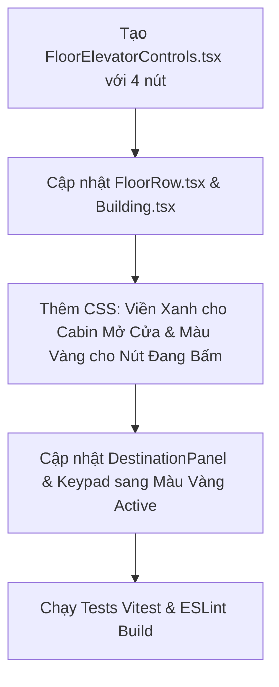

# Kế Hoạch Tái Cấu Trúc Nút Điều Khiển Từng Thang Máy Tại Mỗi Tầng & Hiệu Ứng Trực Quan

- **Mã tài liệu:** `2609301739-per-elevator-floor-controls-refactor.md`
- **Ngày cập nhật:** 2026-09-30 17:41 (GMT+7)
- **Mục tiêu:** 
  1. Bố trí cụm nút điều khiển (`UP`, `DOWN`, `OPEN`, `CLOSE`) riêng biệt cho từng thang máy (E1, E2, E3) tại mỗi tầng.
  2. Bổ sung hiệu ứng màu sắc trực quan: **Viền xanh lá khi thang mở cửa** & **Màu vàng khi nút đang được kích hoạt**.

---

## 1. Yêu Cầu Giao Diện & Màu Sắc Trực Quan (UI & Visual Specs)

### 1.1. Bố Trí Cụm Nút Cho Từng Thang Máy Ở Từng Tầng:
- **Tầng 2 đến Tầng 9:** Đầy đủ **4 nút** cho mỗi thang: `[ ↑ Lên ]` `[ ↓ Xuống ]` `[ <|> Mở ]` `[ >|< Đóng ]`.
- **Tầng 10 (Tầng cao nhất):** Gồm **3 nút**: `[ ↓ Xuống ]` `[ <|> Mở ]` `[ >|< Đóng ]` *(vô hiệu hóa/ẩn `Lên`)*.
- **Tầng 1 (Tầng trệt):** Gồm **3 nút**: `[ ↑ Lên ]` `[ <|> Mở ]` `[ >|< Đóng ]` *(vô hiệu hóa/ẩn `Xuống`)*.

### 1.2. Quy Chuẩn Màu Sắc & Hiệu Ứng (Visual Color Rules):
1. **Trạng thái Mở cửa (Door Open / Opening):**
   - Khi cabin của thang máy đang mở (`OPEN`) hoặc đang trong quá trình mở (`OPENING`): **Cabin có viền màu xanh lá nổi bật kèm hiệu ứng phát sáng neon green** (`border: 2px solid #22c55e`, `box-shadow: 0 0 16px rgba(34, 197, 94, 0.6)`).
2. **Trạng thái Nút đang bấm / Active (Button Pressed State):**
   - Bất kỳ nút nào đang được kích hoạt (yêu cầu gọi tầng `UP`/`DOWN` đang chờ đón, hoặc tầng đích trong cabin đã chọn, hoặc nút cửa đang active): **Đổi sang màu vàng hổ phách nổi bật (Amber/Yellow)** (`background: rgba(245, 158, 11, 0.3)`, `border: 1px solid #f59e0b`, `color: #fbbf24`, `box-shadow: 0 0 14px rgba(245, 158, 11, 0.6)`).

---

## 2. Thiết Kế Lưới Tòa Nhà (Building Grid Structure)

Loại bỏ cột "HALL CALL" chung đơn lẻ ở bên phải. Tích hợp trực tiếp cụm nút điều khiển vào từng ô giếng thang:

```text
+-------+---------------------------------------+---------------------------------------+---------------------------------------+
| FLOOR |              ELEVATOR 1               |              ELEVATOR 2               |              ELEVATOR 3               |
+-------+---------------------------------------+---------------------------------------+---------------------------------------+
|  10F  | [ Cabin E1 (Viền Xanh) ] [↓][<|>][>|<]| [             ]       [↓][<|>][>|<]   | [             ]       [↓][<|>][>|<]   |
|  ...  | [                      ] [↑][↓][<|>][>|<]| [ Cabin E2 ]         [↑][↓][<|>][>|<] | [             ]       [↑][↓][<|>][>|<]|
|   1F  | [                      ] [↑][<|>][>|<]  | [             ]       [↑][<|>][>|<]   | [ Cabin E3 ]          [↑][<|>][>|<]   |
+-------+---------------------------------------+---------------------------------------+---------------------------------------+
```

---

## 3. Các Bước Triển Khai (Action Items)



- [x] **Bước 1: Tạo Component `FloorElevatorControls.tsx`**
  - Nhận `floor: number` và `elevatorId: number`.
  - Hiển thị các nút: `UP` (tầng < 10), `DOWN` (tầng > 1), `OPEN` (`<|>`), `CLOSE` (`>|<`).
  - Gắn class active đổi **màu vàng** (`active-yellow`) khi có request đang chờ.

- [x] **Bước 2: Cập nhật `ElevatorCabin.tsx`**
  - Thêm class `door-open-green` khi `doorState === 'OPEN'` hoặc `doorState === 'OPENING'`.

- [x] **Bước 3: Cập nhật `FloorRow.tsx` & `Building.tsx`**
  - Lưới hiển thị: `[Floor (70px)] [E1 (1fr)] [E2 (1fr)] [E3 (1fr)]`.
  - Trong mỗi ô thang máy ở từng tầng: hiển thị giếng thang/cabin và cụm `FloorElevatorControls` bên cạnh.

- [x] **Bước 4: Cập nhật CSS trong `elevator.css`**
  - Viền xanh lá sáng: `.elevator-cabin.door-open-green { border-color: #22c55e; box-shadow: 0 0 16px rgba(34, 197, 94, 0.6); }`
  - Màu vàng cho nút active: `.active-yellow { background: rgba(245, 158, 11, 0.28); border-color: #f59e0b; color: #fbbf24; box-shadow: 0 0 14px rgba(245, 158, 11, 0.6); }`

- [x] **Bước 5: Kiểm thử và Xác minh (Testing & Verification)**
  - Chạy `yarn lint`, `yarn test`, `yarn build`.

---

## 4. Tiêu Chí Nghiệm Thu (Acceptance Criteria)

- [x] Mỗi tầng từ 2–9 của cả 3 thang máy đều có đủ 4 nút: `UP`, `DOWN`, `OPEN`, `CLOSE`.
- [x] Tầng 10 chỉ có 3 nút: `DOWN`, `OPEN`, `CLOSE`.
- [x] Tầng 1 chỉ có 3 nút: `UP`, `OPEN`, `CLOSE`.
- [x] Khi thang máy mở cửa (`OPEN`/`OPENING`), cabin hiển thị **viền xanh lá neon**.
- [x] Bất kỳ nút nào đang được bấm/active (nút gọi tầng, nút chọn tầng đích), hiển thị **màu vàng rực rỡ**.
- [x] Toàn bộ unit tests và linter pass 100%.
