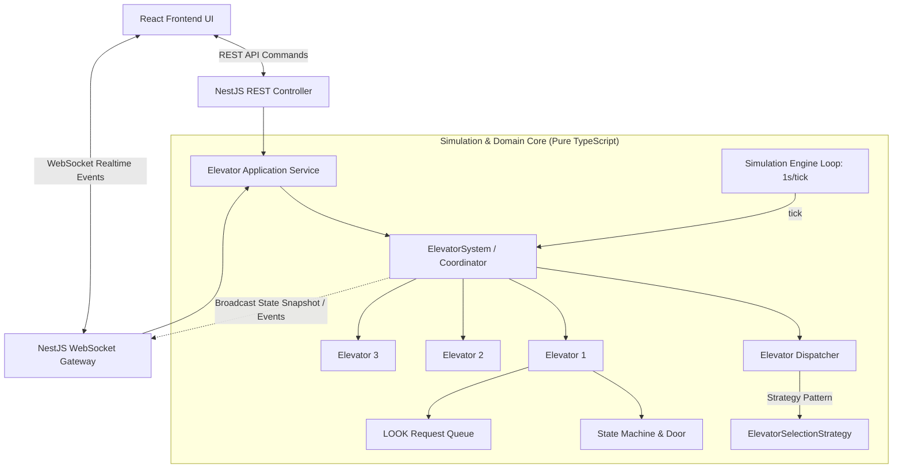
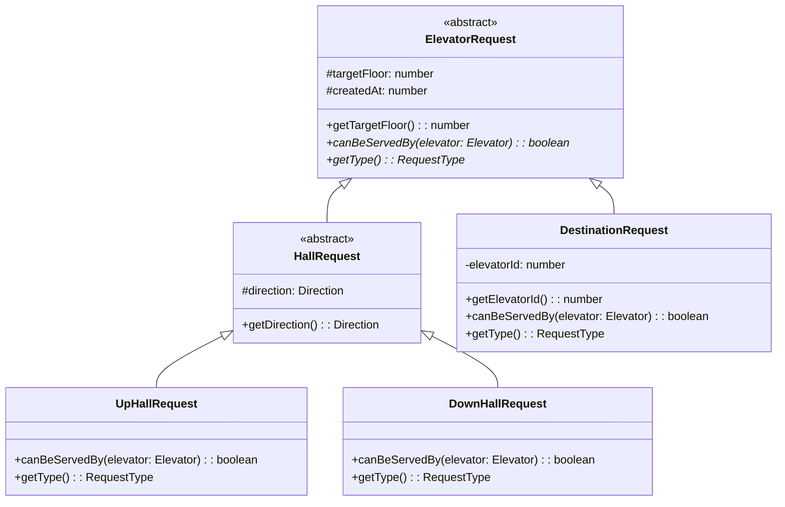
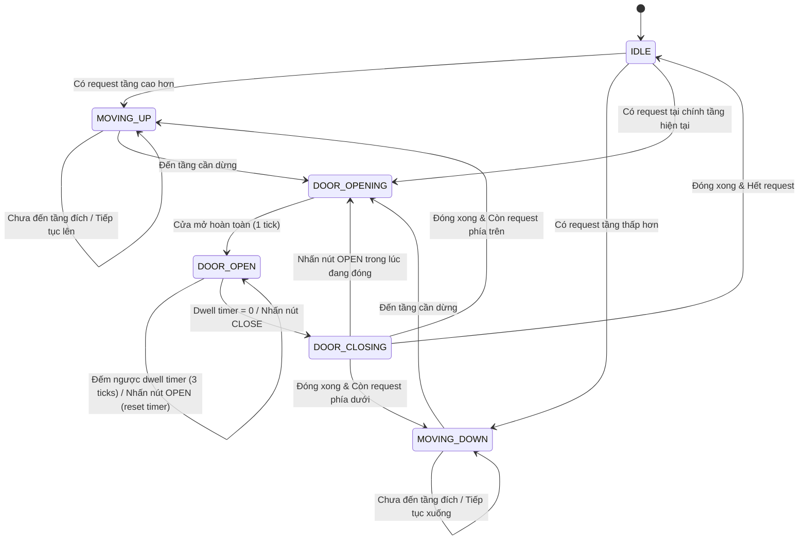
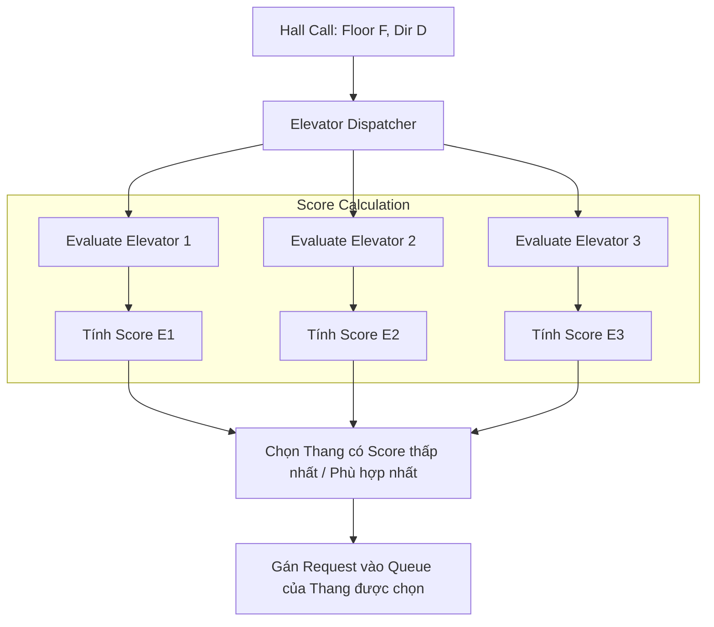

# Tài Liệu Thiết Kế Kỹ Thuật Chi Tiết: Elevator Backend Simulation System

- **Mã tài liệu:** `2609292233-elevator-backend-system-design.md`
- **Ngày tạo:** 2026-09-29 22:33 (GMT+7)
- **Hệ thống:** Backend (NestJS + TypeScript + Socket.IO + In-memory Domain Engine)

---

## 1. Tổng Quan Kiến Trúc (Architectural Overview)

Hệ thống được thiết kế theo mô hình **Domain-Driven OOP Architecture** kết hợp với **Deterministic Simulation Loop (Tick Engine)**. Toàn bộ trạng thái của thang máy được quản lý in-memory nhằm đảm bảo hiệu năng cao nhất, tính nhất quán (consistency), không phụ thuộc vào I/O cơ sở dữ liệu.



---

## 2. Mô Hình Đối Tượng (Domain Modeling & OOP Pillars)

Đề bài yêu cầu thể hiện rõ ràng 3 trụ cột OOP: **Encapsulation (Đóng gói)**, **Inheritance (Kế thừa)**, và **Polymorphism (Đa hình)**.

### 2.1. Phân cấp Đối tượng Yêu cầu (Request Hierarchy - Inheritance & Polymorphism)

Hệ thống phân tách rõ ràng giữa **HallRequest** (gọi ở sảnh, có chiều) và **DestinationRequest** (chọn tầng đích bên trong cabin):



* **Polymorphic Behavior (`canBeServedBy`)**:
  * `UpHallRequest`: Trả về `true` nếu thang đang `MOVING_UP` và `currentFloor <= targetFloor`.
  * `DownHallRequest`: Trả về `true` nếu thang đang `MOVING_DOWN` và `currentFloor >= targetFloor`.
  * `DestinationRequest`: Trả về `true` nếu request thuộc chính thang máy đó (`this.elevatorId === elevator.getId()`) và thang đang di chuyển theo hướng hướng tới `targetFloor`.

### 2.2. Đóng gói Thực thể Thang Máy (Elevator Entity - Encapsulation)

Thực thể `Elevator` đóng gói toàn bộ trạng thái nội tại (`currentFloor`, `direction`, `state`, `door`, `requestsQueue`). Mọi sự thay đổi trạng thái phải đi qua các public method có validation và tuân thủ State Transition:

```typescript
export class Elevator {
  private readonly id: number;
  private currentFloor: number = 1;
  private direction: Direction = Direction.IDLE;
  private state: ElevatorState = ElevatorState.IDLE;
  private door: Door = new Door();
  private readonly destinationRequests: Set<number> = new Set();
  private readonly hallRequests: Set<HallRequest> = new Set();

  // Public Domain Methods
  public addDestination(targetFloor: number): void;
  public assignHallRequest(request: HallRequest): void;
  public tick(): ElevatorEvent[];
  public pressOpenDoor(): void;
  public pressCloseDoor(): void;
  
  // Getters (Readonly snapshots)
  public getSnapshot(): ElevatorSnapshot;
}
```

---

## 3. Máy Trạng Thái & Cơ Chế Cửa (State Machine & Door Lifecycle)

Mỗi thang máy vận hành dựa trên State Machine nghiêm ngặt nhằm tránh các lỗi bất biến (invariants), đặc biệt: **Thang máy không bao giờ được phép di chuyển khi cửa chưa đóng hoàn toàn**.



### Chi tiết Timer và nút Open/Close:
* `DOOR_DWELL_TICKS = 3` (3 giây giữ cửa mặc định).
* **Lệnh `openDoor`:**
  * Nếu đang ở `DOOR_OPEN`: Reset `dwellTimer = DOOR_DWELL_TICKS`.
  * Nếu đang ở `DOOR_CLOSING`: Đảo chiều ngay lập tức sang `DOOR_OPENING`.
  * Nếu đang `IDLE` hoặc `DOOR_OPENING`: Đảm bảo trạng thái mở.
  * Nếu đang `MOVING`: Bỏ qua (không cho phép mở cửa khi đang chạy - đảm bảo an toàn).
* **Lệnh `closeDoor`:**
  * Nếu đang ở `DOOR_OPEN`: Đặt `dwellTimer = 0`, ngay lập tức chuyển sang `DOOR_CLOSING`.

---

## 4. Thuật Toán Điều Phối & Di Chuyển (Dispatching & LOOK Algorithm)

### 4.1. Thuật toán phân bổ thang máy (Elevator Dispatching - Strategy Pattern)

Khi có một `HallRequest` từ sảnh, `ElevatorDispatcher` sẽ tính toán điểm phạt chi phí (Cost/Suitability Score) cho từng thang máy để chọn thang tối ưu nhất:

$$\text{Suitability Score} = \text{Distance} + \text{Direction Penalty} + \text{Load Penalty}$$



**Quy tắc tính Score cụ thể:**
1. **Thang đang `IDLE`:** $\text{Score} = |E.\text{floor} - F|$.
2. **Thang di chuyển cùng chiều ($E.\text{dir} == D$) và nằm trên đường đi:**
   * Thang đi `UP` và $E.\text{floor} \le F$: $\text{Score} = (F - E.\text{floor}) + \text{QueueLength} \times 1$.
   * Thang đi `DOWN` và $E.\text{floor} \ge F$: $\text{Score} = (E.\text{floor} - F) + \text{QueueLength} \times 1$.
3. **Thang đang di chuyển nhưng ngược chiều hoặc đã đi qua tầng $F$:**
   * Thang phải hoàn thành hành trình hiện tại rồi mới quay lại đón, do đó bị cộng thêm điểm phạt lớn:
   $$\text{Score} = (\text{Khoảng cách đến tầng xa nhất}) + (\text{Khoảng cách từ tầng xa nhất về } F) + \text{Penalty}(15\text{ điểm}).$$

### 4.2. Thuật toán di chuyển nội bộ (LOOK Algorithm)

Mỗi thang máy khi chạy sẽ tuân theo nguyên lý **LOOK (Elevator Scan)**:
1. Tiếp tục duy trì chiều hiện tại (`UP` hoặc `DOWN`) cho đến khi xử lý hết toàn bộ request cùng chiều phía trước.
2. Dừng tại tầng $F$ nếu:
   - Có `DestinationRequest` tại $F$, **HOẶC**
   - Có `HallRequest` cùng chiều tại $F$, **HOẶC**
   - Không còn request nào phía trước theo chiều hiện tại, nhưng có `HallRequest` ngược chiều tại chính tầng $F$ (tầng quay đầu).
3. Khi không còn bất kỳ request nào phía trước:
   - Nếu có request ở hướng ngược lại: Đổi chiều (`UP` $\leftrightarrow$ `DOWN`).
   - Nếu không còn request nào: Chuyển về `IDLE`.

---

## 5. Tổng Hợp Các Edge Cases & Phương Án Xử Lý

| STT | Tình huống (Edge Case) | Hành vi chuẩn của hệ thống |
| :--- | :--- | :--- |
| **1** | **Bấm trùng nút gọi (Duplicate Hall Call)** | Hệ thống tự động deduplicate (Idempotent). Nếu tầng 5 đã có yêu cầu UP đang chờ phân bổ/đang có thang đến, không tạo thêm request thừa. |
| **2** | **Gọi thang tại chính tầng thang đang đỗ IDLE** | Thang tại tầng đó lập tức mở cửa (`DOOR_OPENING` $\to$ `DOOR_OPEN`), không cần di chuyển. |
| **3** | **Chọn tầng đích trùng tầng hiện tại** | Bỏ qua nếu cửa đang mở, hoặc kích hoạt mở cửa lại nếu cửa đang đóng. |
| **4** | **Bấm chọn tầng đích ngoài phạm vi [1, 10]** | Validation layer từ chối ngay lập tức bằng `BadRequestException (400)`. |
| **5** | **Tầng biên (Floor 1 & Floor 10)** | Tầng 1 không thể bấm `DOWN`. Tầng 10 không thể bấm `UP`. |
| **6** | **Nhiều thang cùng IDLE** | Chọn thang gần nhất với tầng gọi. Nếu khoảng cách bằng nhau, chọn theo thứ tự ưu tiên hoặc thang ít số lượt di chuyển nhất. |
| **7** | **Bấm Open khi thang đang chạy giữa các tầng** | Không có tác dụng (bị vô hiệu hóa để bảo đảm an toàn). |
| **8** | **Khách bấm nhiều tầng đích cùng lúc trong cabin** | Thang máy lưu toàn bộ tầng đích vào tập hợp `destinationRequests`, tự động dừng lần lượt theo thứ tự tầng trên đường đi. |

---

## 6. Thiết Kế API & Realtime Contracts

### 6.1. REST API Commands

```http
### 1. Gọi thang tại sảnh tầng (Hall Call)
POST /api/elevators/call
Content-Type: application/json

{
  "floor": 5,
  "direction": "UP" // "UP" | "DOWN"
}

### 2. Chọn tầng đích trong cabin (Destination Call)
POST /api/elevators/:id/destination
Content-Type: application/json

{
  "floor": 8
}

### 3. Điều khiển cửa thang máy
POST /api/elevators/:id/door/open
POST /api/elevators/:id/door/close

### 4. Lấy toàn bộ trạng thái hệ thống (Snapshot)
GET /api/elevators
```

### 6.2. WebSocket Gateway Events

* **Namespace / Channel:** `/elevator-ws`
* **Server Emits:**
  * `simulation:tick`: Broadcast trạng thái 3 thang máy mỗi giây (`ElevatorSnapshot[]`).
  * `elevator:arrived`: `{ elevatorId: 1, floor: 5, direction: "UP" }` (giúp FE kích hoạt modal chọn tầng cho thang 1).
  * `elevator:door_state_changed`: `{ elevatorId: 1, doorState: "OPEN" | "CLOSED" | "OPENING" | "CLOSING" }`.
  * `request:added`: `{ type: "HALL" | "DESTINATION", floor: 5, direction?: "UP", elevatorId?: 1 }`.

---

## 7. Cấu Trúc Mã Nguồn (Project Structure)

```text
elevator-be/
├── src/
│   ├── domain/                         # Pure TypeScript (Zero external framework dependencies)
│   │   ├── constants/
│   │   │   └── elevator.constants.ts   # NUM_ELEVATORS = 3, NUM_FLOORS = 10, DOOR_DWELL = 3
│   │   ├── enums/
│   │   │   ├── direction.enum.ts       # UP, DOWN, IDLE
│   │   │   ├── elevator-state.enum.ts  # IDLE, MOVING_UP, MOVING_DOWN, DOOR_OPENING, DOOR_OPEN, DOOR_CLOSING
│   │   │   └── door-state.enum.ts      # OPEN, CLOSED, OPENING, CLOSING
│   │   ├── entities/
│   │   │   ├── door.ts                 # Encapsulates door timing & state
│   │   │   └── elevator.ts             # Core Elevator State & LOOK movement logic
│   │   ├── requests/
│   │   │   ├── elevator-request.ts     # Abstract base class
│   │   │   ├── hall-request.ts         # UpHallRequest, DownHallRequest
│   │   │   └── destination-request.ts  # Cabin Destination Request
│   │   ├── strategies/
│   │   │   ├── selection-strategy.interface.ts
│   │   │   └── nearest-suitable-strategy.ts
│   │   └── elevator-system.ts          # Aggregate root quản lý 3 thang máy & Dispatcher
│   │
│   ├── simulation/
│   │   └── simulation.engine.ts        # Tick interval loop quản lý thời gian
│   │
│   ├── modules/
│   │   ├── elevator/
│   │   │   ├── elevator.controller.ts  # REST Endpoints
│   │   │   ├── elevator.gateway.ts     # WebSocket Broadcast & Client Listeners
│   │   │   ├── elevator.service.ts     # Bridge giữa NestJS và ElevatorSystem
│   │   │   └── elevator.module.ts
│   │
│   ├── app.module.ts
│   └── main.ts
└── test/
    ├── domain/
    │   ├── elevator.spec.ts            # Unit tests cho LOOK & State Machine
    │   ├── dispatcher.spec.ts          # Unit tests cho Strategy dispatching
    │   └── door-lifecycle.spec.ts      # Unit tests cho Open/Close button & Dwell timer
    └── e2e/
        └── elevator.e2e-spec.ts
```
